# CUTLINE — сервис записи в барбершоп

Веб-приложение для одного барбершопа с несколькими мастерами: клиент выбирает услугу, мастера, дату и свободное время и получает подтверждённую запись; по личной ссылке может её посмотреть, перенести или отменить. Мастер видит свой календарь, администратор управляет расписанием, услугами, мастерами, доступами и записями.

> **CUTLINE — рабочее имя демонстрационного бренда.** Товарный знак и домен не проверялись. Все мастера, цены, длительности, часы работы и записи в демо-данных **вымышлены**.

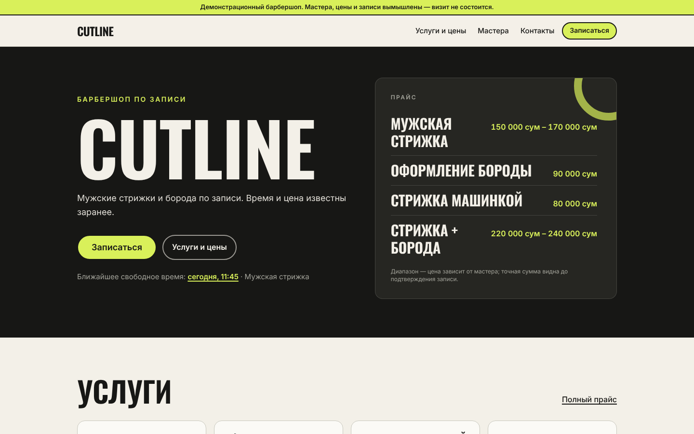

## Содержание

- [Стек](#стек)
- [Посмотреть локально за одну команду](#посмотреть-локально-за-одну-команду)
- [Быстрый старт (Docker)](#быстрый-старт-docker)
- [Локальная разработка](#локальная-разработка)
- [Настройка реального салона (live)](#настройка-реального-салона-live)
- [Резервное копирование и восстановление](#резервное-копирование-и-восстановление)
- [Как это устроено](#как-это-устроено)
- [Проверки и их результаты](#проверки-и-их-результаты)
- [Уведомления: что настроено](#уведомления-что-настроено)
- [Известные ограничения](#известные-ограничения)
- [Что нужно от владельца для live-запуска](#что-нужно-от-владельца-для-live-запуска)
- [Скриншоты](#скриншоты)

## Стек

| Слой | Выбор |
| --- | --- |
| Приложение | Next.js 16 (App Router, Turbopack), React 19, TypeScript strict |
| БД | PostgreSQL 16, явные SQL-миграции (`migrations/*.sql`), Drizzle ORM для запросов |
| Валидация | Zod на всех границах (API, Server Actions) |
| Стили | Tailwind CSS 4, собственные компоненты |
| Сотрудники | Серверные сессии (случайный токен в httpOnly-cookie, в БД только SHA-256), пароли — scrypt |
| Уведомления | Outbox в БД + фоновый worker, e-mail через SMTP (nodemailer) — только если настроен |
| Тесты | Vitest (unit + интеграция на реальном Postgres), Playwright (E2E) |
| Шрифты | Oswald и Inter (SIL Open Font License 1.1), локально через `@fontsource-variable/*`, с кириллицей |

Версии зафиксированы в `package-lock.json`.

## Посмотреть локально за одну команду

Нужен только Docker Desktop (или docker + compose v2):

```bash
git clone https://github.com/boldpunk/cutline.git && cd cutline
git checkout claude/new-session-6xc1wf   # пока PR не влит
./scripts/local-demo.sh
```

Скрипт создаст `.env` со случайным секретом, соберёт образ, поднимет Postgres + приложение + worker, заполнит вымышленными демо-данными и напечатает адреса: сайт — http://localhost:3000, кабинет — http://localhost:3000/staff (`admin@demo.cutline` / `demo-cutline-2026`). Порт занят — `APP_PORT=3005 ./scripts/local-demo.sh`. Остановить — `./scripts/local-demo.sh stop`, стереть данные — `./scripts/local-demo.sh reset`. На Windows запускайте из Git Bash или WSL.

## Быстрый старт (Docker)

```bash
cp .env.example .env
# обязательно задайте APP_SECRET (32+ случайных символа):
node -e "console.log(require('crypto').randomBytes(32).toString('base64url'))"

docker compose up -d --build                 # db + migrate + app + worker
docker compose run --rm seed-demo            # ТОЛЬКО для демо: вымышленный салон
open http://localhost:3000
```

- Данные Postgres лежат в томе `pgdata` и переживают `docker compose restart` / `down` / `up` (проверено, см. A13). `docker compose down -v` удаляет данные.
- Демо-вход в кабинет `/staff`: `admin@demo.cutline` (администратор), `timur@demo.cutline`, `alisher@demo.cutline`, `dmitry@demo.cutline` (мастера). Пароль — `demo-cutline-2026` или значение `DEMO_PASSWORD` при сидировании.
- Сервис `migrate` применяет миграции при каждом запуске (идемпотентно, под advisory lock).

## Локальная разработка

Нужны Node.js ≥ 22 и PostgreSQL 16 (с расширениями `btree_gist`, `citext` — входят в стандартную поставку).

```bash
npm ci
cp .env.example .env            # DATABASE_URL, APP_SECRET
npm run db:migrate
npm run db:seed-demo            # вымышленные данные + демо-учётки
npm run dev                     # http://localhost:3000
npm run worker                  # в отдельном терминале — доставка уведомлений и очистка
```

| Команда | Что делает |
| --- | --- |
| `npm run typecheck` | `tsc --noEmit` |
| `npm run build` / `npm start` | production-сборка / запуск |
| `npm test` | unit + интеграционные тесты (нужна БД `cutline_test`, см. ниже) |
| `npm run test:e2e` | Playwright: поднимает `next start` на :3100 с отдельной БД `cutline_e2e` (нужен `npm run build`) |
| `npm run check:contrast` | контраст реальных пар цветов по WCAG |
| `npm run create-admin -- --email …` | создать администратора / сбросить ему пароль |
| `npm run db:init-live -- --name "…"` | подготовить пустую production-БД без тестовых данных |
| `node scripts/screenshots.mjs` | снять скриншоты из `docs/screenshots` с запущенного демо |

Тестовые базы: `createdb cutline_test && createdb cutline_e2e` (адреса можно переопределить `DATABASE_URL_TEST`, `DATABASE_URL_E2E`). Тесты сами пересоздают схему.

## Настройка реального салона (live)

1. **Чистая БД без демо-данных**:
   ```bash
   npm run db:init-live -- --name "Название салона" --timezone Asia/Tashkent
   ADMIN_PASSWORD='…' npm run create-admin -- --email owner@example.com --name "Имя"
   ```
   В Docker: `docker compose run --rm app npm run db:init-live -- --name "…"` и `docker compose run --rm -e ADMIN_PASSWORD='…' app npm run create-admin -- --email …`. Скрипт `init-live` не создаёт мастеров, услуг и записей. **Не запускайте `seed-demo`** — он к тому же откажется работать на базе в режиме live.
2. В `/staff/settings` заполните **только подтверждённые** данные: адрес, телефон, ссылки, обещание на первом экране, правила записи (шаг, минимум до записи, горизонт, срок отмены), оператора персональных данных, контакт и срок хранения. Незаполненные блоки на сайте скрываются.
3. `/staff/schedule` — часы салона и закрытые дни; `/staff/barbers` — мастера, фото (только с правом публикации), их часы; `/staff/services` — услуги, цены, кто что выполняет и индивидуальные цены.
4. `/staff/users` — учётки мастерам (публичной регистрации нет).
5. Переключите режим на **Live** в настройках (без реквизитов оператора персональных данных переключение отклоняется). До этого сайт показывает плашку «Демонстрационный барбершоп».
6. Production-переменные: `APP_URL=https://ваш-домен`, `COOKIE_SECURE=true` (за HTTPS), `TRUST_PROXY=true` только за своим reverse-proxy (иначе ограничения частоты по IP не применяются — ограничения по записи/номеру телефона работают всегда). Логи доступа reverse-proxy не должны сохранять пути `/booking/*` (в пути — приватный токен).

**Смена часового пояса.** После появления записей поле заблокировано в интерфейсе и на сервере: часы работы хранятся как локальное время салона, и смена зоны молча изменила бы их смысл. Процедура: сделайте резервную копию → убедитесь, что расписание (`weekly_availability`, `schedule_exceptions`) в новой зоне означает то же, что нужно владельцу → в `psql`: `update salon_settings set timezone = 'Europe/…'` → проверьте календарь. Моменты записей хранятся в UTC и не меняются.

## Резервное копирование и восстановление

```bash
# бэкап (включает фото — они хранятся в БД)
docker compose exec -T db pg_dump -U cutline -Fc cutline > backup-$(date +%F).dump

# восстановление в пустую базу
docker compose exec -T db createdb -U cutline cutline_restored
docker compose exec -T db pg_restore -U cutline -d cutline_restored --no-owner < backup-YYYY-MM-DD.dump
```

Без Docker — те же `pg_dump` / `pg_restore` с вашим `DATABASE_URL`. Цикл бэкап → восстановление в отдельную базу проверен (9 записей восстановлены).

## Как это устроено

### Модель данных (`migrations/0001_init.sql`)

`salon_settings`, `users`, `sessions`, `barbers`, `services`, `barber_services` (цена/длительность мастера), `weekly_availability` (часы по дням недели; `barber_id NULL` — часы салона), `schedule_exceptions` (закрытые дни и особые часы — салона или мастера), `time_blocks` (перерывы, отпуска, прочее), `bookings` (публично-безопасные данные + snapshot названия/цены/длительности/buffer), `booking_contacts` (персональные данные отдельно), `booking_events` (история записи без телефонов), `audit_log` (прочие изменения сотрудников), `notification_outbox`, `idempotency_keys`, `rate_limits`, `media` (фото).

Все моменты — `timestamptz` (UTC); расписание — минуты от локальной полуночи в зоне салона (`Asia/Tashkent` по умолчанию). Интервалы полуоткрытые `[start, end)`.

### Защита от двойного бронирования

1. **На уровне БД**: `bookings.occupied_range = tstzrange(occupied_from, occupied_until, '[)')` (сгенерированный столбец, включает buffer) и
   `EXCLUDE USING gist (barber_id WITH =, occupied_range WITH &&) WHERE (status = 'confirmed')` (+ `btree_gist`). Тест вставляет пересекающуюся запись в обход приложения — БД отклоняет её с `23P01`.
2. **Записи против блокировок/графика**: все операции, меняющие занятость мастера (создание, перенос, блокировка, изменение часов, закрытие дня, деактивация мастера), берут `pg_advisory_xact_lock` по мастеру (в фиксированном порядке — без взаимоблокировок), затем перепроверяют расписание и пишут — в одной транзакции. Гонка «запись vs блокировка на то же время» покрыта тестом.
3. **Идемпотентность создания**: ключ создаётся клиентом на набор данных; строка `idempotency_keys` вставляется в той же транзакции, что и запись. Параллельный запрос с тем же ключом ждёт и получает тот же ответ (включая тот же приватный токен — он хранится зашифрованным AES-GCM 24 часа, затем удаляется worker'ом). Тот же ключ с другими данными — ошибка 422.
4. **Перенос** — обновление той же строки в одной транзакции: новое время проверяется и занимается вместе с освобождением старого; при неудаче старая запись остаётся подтверждённой. Повторная отправка того же переноса — no-op без лишнего события. Повторная отмена — без ошибки и без второго события.

### Расчёт слотов (`src/lib/domain/slots.ts`)

Чистая функция: рабочие окна = часы салона ∩ часы мастера (с учётом исключений на дату), минус записи (с buffer) и блокировки; старт — на сетке шага от локальной полуночи; весь интервал `[start − buffer_before, start + длительность + buffer_after)` обязан целиком лежать в одном окне. Минимум до записи и горизонт применяются для клиентов; администратор может записать «сейчас» (визит с улицы), но не поверх занятого времени. «Любой мастер»: слоты объединяются, у каждого — список свободных мастеров в стабильном порядке; назначается первый, клиент видит и может сменить мастера на экране проверки; если у назначенного иная цена, сервер не меняет её молча (`price_changed`).

### Клиентская ссылка

Токен — 32 байта из CSPRNG (`base64url`), в БД только SHA-256. До проверки страница ничего не показывает о записи; проверка — последние 4 цифры телефона (это практичный вариант для v1 без SMS, **не сильная аутентификация**): 5 попыток на запись за 15 минут и 30 в час с IP (при `TRUST_PROXY`). После проверки — httpOnly-cookie (HMAC, 30 минут). Для `/booking/*` и `/staff*`: `Referrer-Policy: no-referrer`, `X-Robots-Tag: noindex`, `Cache-Control: private, no-store`, никаких сторонних ресурсов. Страница успеха `/booking/success` получает данные через `sessionStorage`, а не через URL. Публичного поиска записей по телефону нет — это делает администратор в кабинете.

### Права

Проверяются на сервере в каждой странице и Server Action (`requireStaff` / `requireAdmin`), а не скрытием кнопок. Мастер видит только свои записи и контакты, отмечает «состоялся/не пришёл» после начала визита, блокирует своё время (если разрешено). Администратор — всё остальное. CSRF: Server Actions проверяют Origin (встроено в Next.js), cookie `SameSite=Lax`; публичные POST-endpoint'ы проверяют `Origin`.

## Проверки и их результаты

Запуск от 16–17.10.2026 в этом окружении (Node 22, PostgreSQL 16.15, Chromium из Playwright):

| Проверка | Команда | Результат |
| --- | --- | --- |
| Типы | `npm run typecheck` | ✅ без ошибок |
| Сборка | `npm run build` | ✅ |
| Unit + интеграция | `npm test` | ✅ 53/53 (6 файлов) |
| E2E | `npm run test:e2e` | ✅ 10/10 (desktop 1440 + mobile 360 Pixel 7, против `next start`) |
| Контраст | `npm run check:contrast` | ✅ все используемые пары ≥ 4.5:1 (см. ниже) |
| Docker | `docker compose up`, restart, down/up | ✅ данные сохраняются |

Соответствие таблице приёмки:

| ID | Чем проверено | Итог |
| --- | --- | --- |
| A01 | E2E `client-journey`: выбор → подтверждение → итоговый экран (время, цена, мастер совпадают); интеграция «A01 create» | ✅ |
| A02 | Интеграция: 12 параллельных запросов на один слот и 4 на пересекающиеся → ровно 1 успех, проигравшие получают `slot_taken` с новыми вариантами; E2E: два HTTP-клиента → 201 и 409 | ✅ |
| A03 | Интеграция: 6 параллельных + поздний повтор с одним ключом → 1 запись, 1 событие; E2E по HTTP | ✅ |
| A04 | Интеграция: перерыв, многодневный отпуск, закрытие салона — слоты исчезают, день помечен «выходной» | ✅ |
| A05 | Unit + интеграция: услуга с buffer у границы закрытия/сокращённого дня доступна только целиком | ✅ |
| A06 | Интеграция: перенос на занятое время → старая запись подтверждена, событий переноса нет | ✅ |
| A07 | Интеграция: перенос и отмена освобождают слот (его тут же бронируют), события записаны ровно один раз | ✅ |
| A08 | E2E: `/staff/*` без сессии → вход, `/staff/export` → 404, мастер не видит админ-страницы и чужие записи (404), публичный API не содержит имён/телефонов, cross-site POST → 403 | ✅ |
| A09 | Интеграция: цена изменена после записи → запись хранит старую, новая запись требует новую | ✅ |
| A10 | Интеграция + E2E: сокращение часов, закрытие дня, деактивация мастера при будущих записях отклоняются со списком записей; после ручной отмены — сохраняются | ✅ |
| A11 | Интеграция: реальный SMTP-транспорт на закрытый порт → запись сохранена, outbox `queued` с ошибкой, после 5 попыток `failed`; в ошибке нет секретов и адреса | ✅ |
| A12 | E2E: нет горизонтальной прокрутки на 360/390/768/1024/1440 для публичных страниц; полный путь записи tap'ами на телефоне; фиксированная кнопка не перекрывает «Подтвердить» | ✅ |
| A13 | Вручную: запись через API → `docker compose restart` → `down` + `up` → запись, сотрудники, расписание на месте | ✅ |
| A14 | Плашка «Демонстрационный барбершоп» на всех страницах, подтверждение «визит не состоится», нет адреса/телефона в демо; live включается владельцем только с реквизитами | ✅ |

**Контраст.** Предложенный Muted `#77776F` на Paper даёт 3.96:1 — мало для мелкого текста, поэтому он используется только для крупного текста/декора, а мелкий второстепенный текст — `#5F5F58` (5.65:1). Акцент `#D9F05A` на светлом фоне не используется для текста (1.11:1) — только как фон под тёмным текстом (14.16:1).

## Уведомления: что настроено

| Канал | Состояние |
| --- | --- |
| Подтверждение на экране, код записи, личная ссылка, `.ics` | ✅ всегда |
| E-mail (подтверждение, перенос, отмена, напоминание) | ⚙️ работает **только если заданы `SMTP_*`**. Без них поле e-mail в форме не показывается, сайт не обещает писем, outbox не заполняется. Напоминание — за `REMINDER_HOURS_BEFORE` ч, отменяется при отмене/переносе. В этом окружении SMTP не настроен; отправка проверена тестами (успех/ошибка/повторы) |
| SMS, Telegram | ❌ не реализовано (следующий этап), на сайте не упоминается как готовое |

Журнал доставки — `/staff/notifications` и карточка записи.

## Известные ограничения

- **Фотографий нет.** Лицензированных фото мастеров/салона нет; на первом экране вместо фото — «прайс-табло» из реальных данных БД, у мастеров — инициалы. Администратор может загрузить фото (с подтверждением права публикации).
- **Проверка по 4 цифрам телефона — не сильная аутентификация.** Защищена ограничением попыток; знание ссылки + 4 цифр даёт доступ к записи.
- Письма не содержат приватную ссылку (токен хранится только хешем); ссылку клиент сохраняет с экрана подтверждения.
- Доставка e-mail — «как минимум один раз»: при падении worker'а между отправкой и записью статуса письмо может уйти повторно.
- Перенос клиентом показывает только слоты, не пересекающиеся с его же текущей записью (сдвиг на 15 минут внутрь своего интервала доступен через администратора — сервер это поддерживает).
- Изменение часового пояса после появления записей — только ручной процедурой.
- Сетка «Неделя» в кабинете — от ширины планшета; на телефоне — список по дням (функции те же).
- Сотрудник не может сам сменить пароль — это делает администратор (или `npm run create-admin` для администратора).
- В `next dev` в консоль пишутся пути запросов, включая `/booking/<token>`; `next start` запросы не логирует, но логи reverse-proxy нужно настроить отдельно.
- Docker-образ собран и проверен здесь через зеркало `mirror.gcr.io` и прокси песочницы (Docker Hub ограничил частоту); `Dockerfile` стандартный.
- Сборка стека в Docker рассчитана на один сервер; горизонтальное масштабирование не проверялось (блокировки и лимиты хранятся в Postgres, поэтому несколько экземпляров app/worker допустимы).
- Юридический текст `/privacy` — шаблон, не юридическая консультация.

## Что нужно от владельца для live-запуска

1. Название (и проверка товарного знака/домена), фактический адрес, ссылка на карту, телефон, соцсети.
2. Прайс: услуги, описания, длительности, цены в сумах, buffer подготовки/уборки; кто из мастеров что выполняет и где цена отличается.
3. Мастера: имена, подтверждённые специализации/описания, фото с правом публикации.
4. График салона и каждого мастера, перерывы, отпуска, праздничные закрытия.
5. Правила: шаг слотов, минимум до записи, горизонт, срок переноса/отмены.
6. Персональные данные: оператор (юр. лицо/ИП), контакт, срок хранения, проверенный юристом текст политики и номер его версии.
7. Домен с HTTPS, сервер/хостинг Postgres, регулярные бэкапы.
8. По желанию — SMTP-доступ для писем (и решение о напоминаниях).

## Скриншоты

| | |
| --- | --- |
| 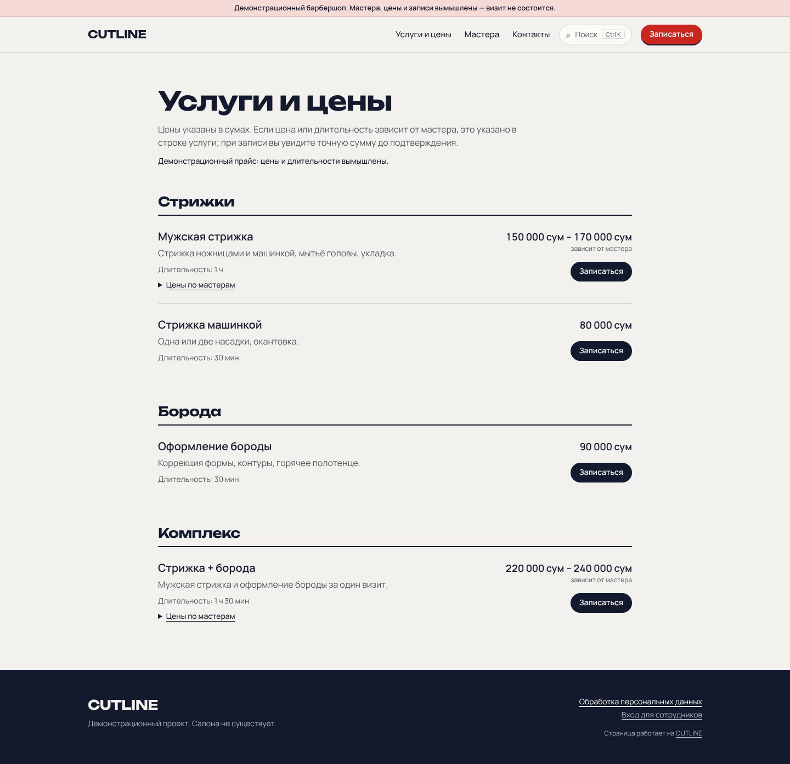 | 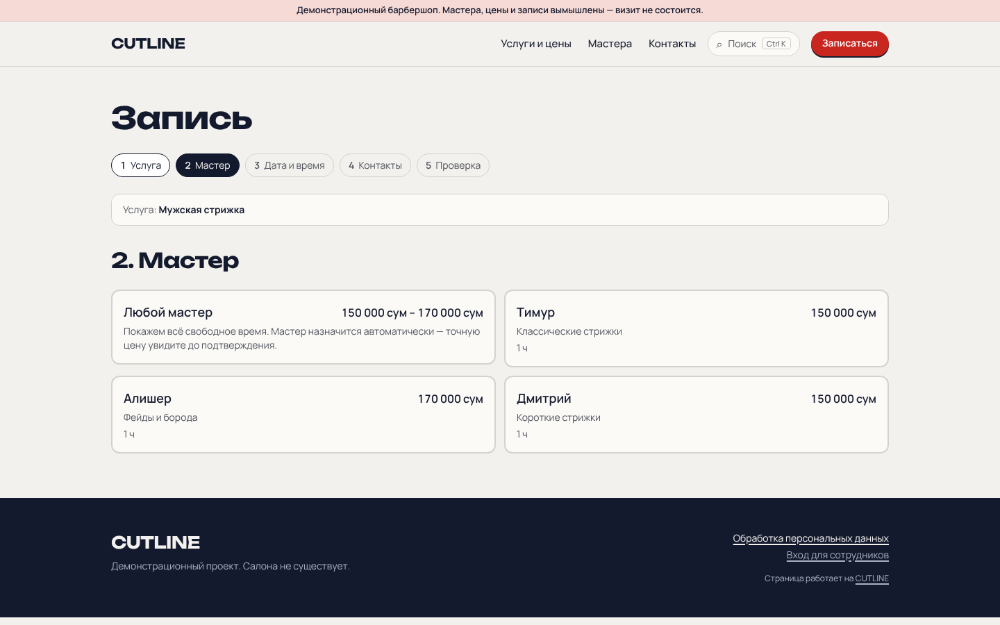 |
| 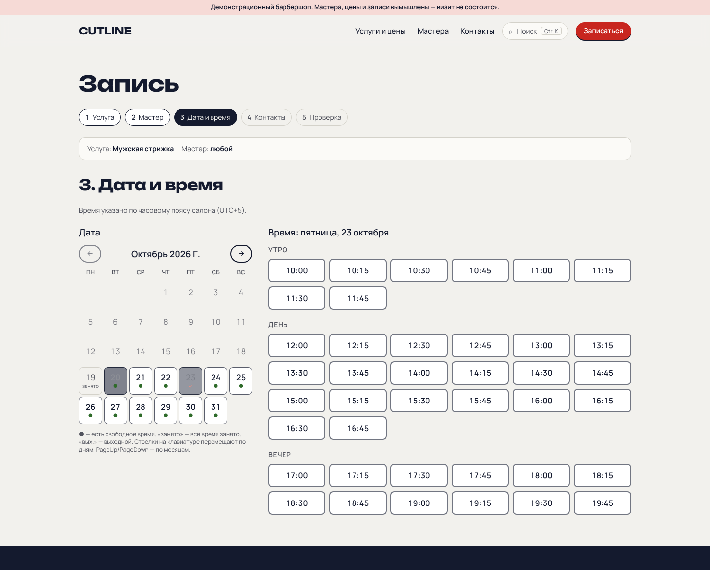 | 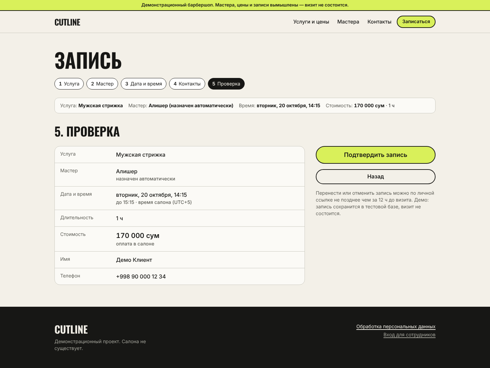 |
| 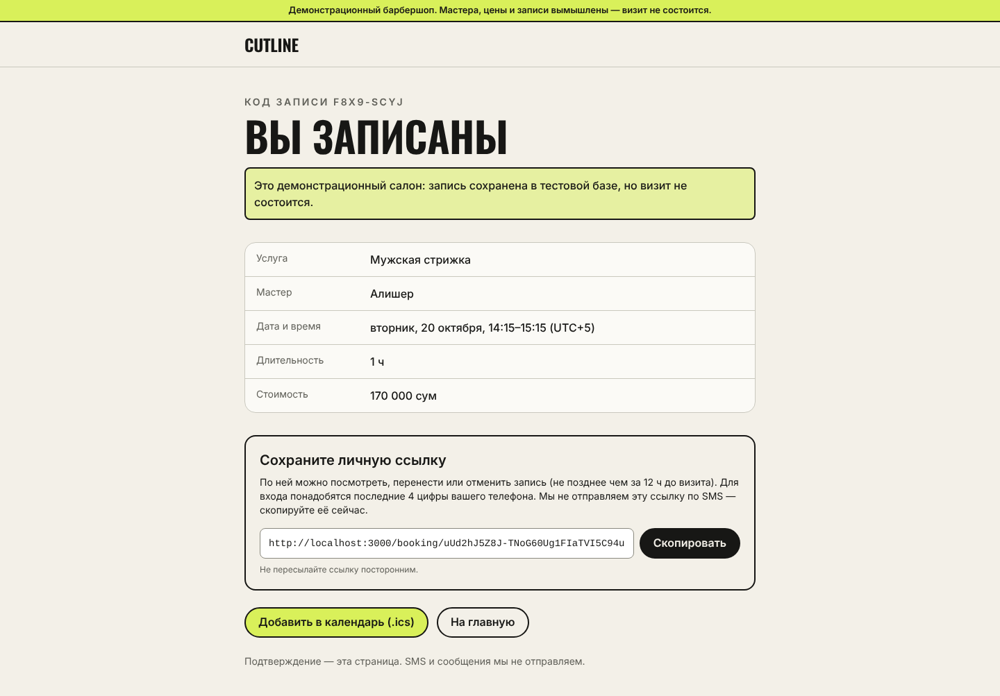 | 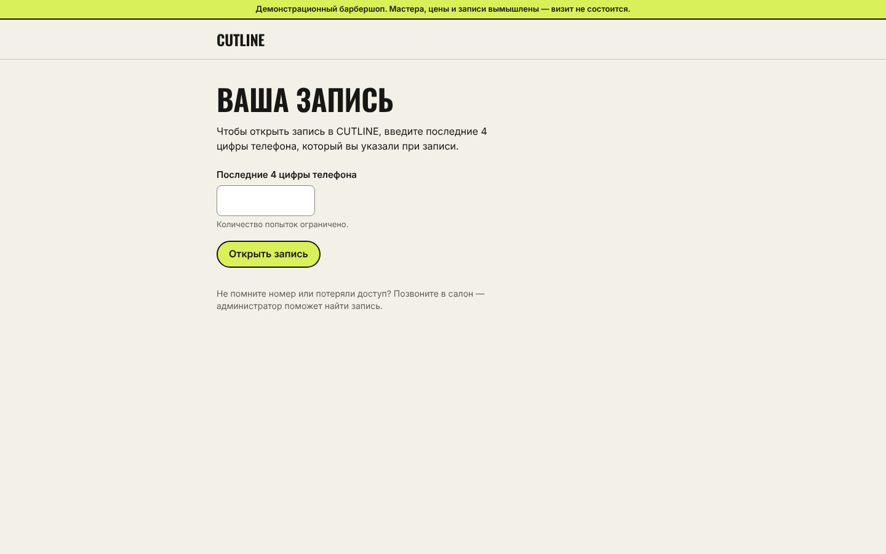 |
| 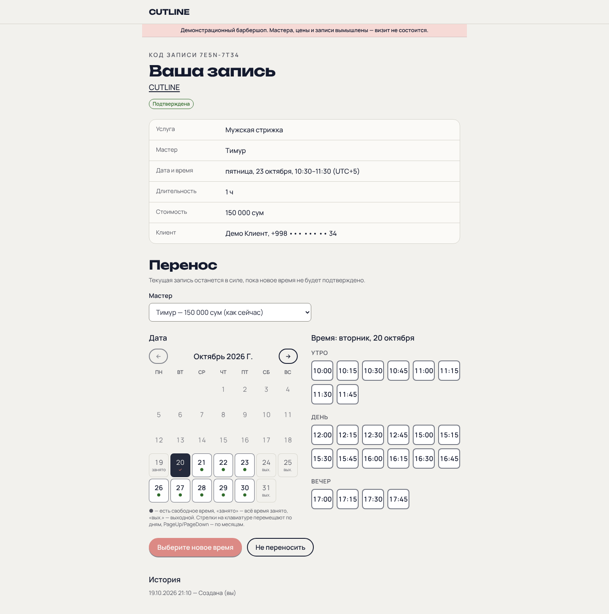 | 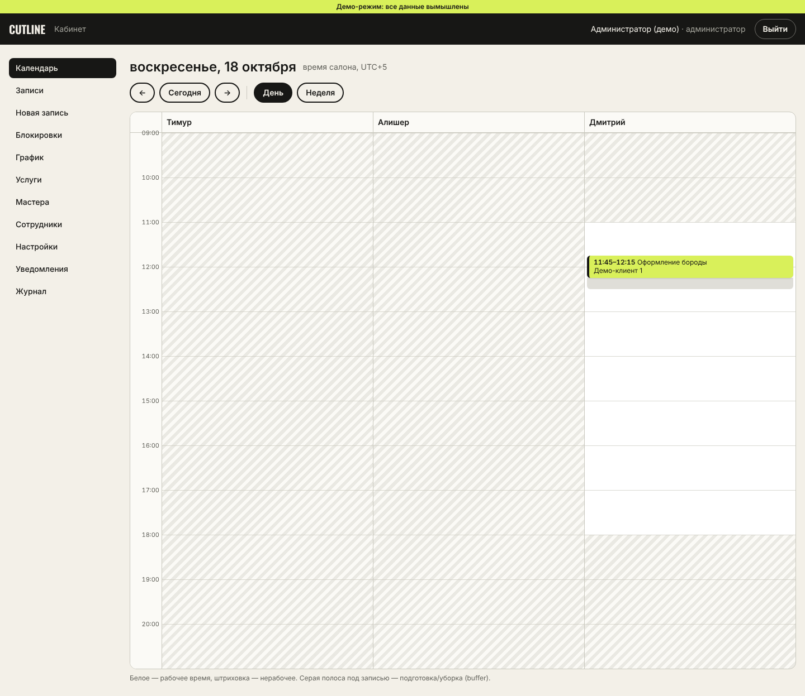 |
| 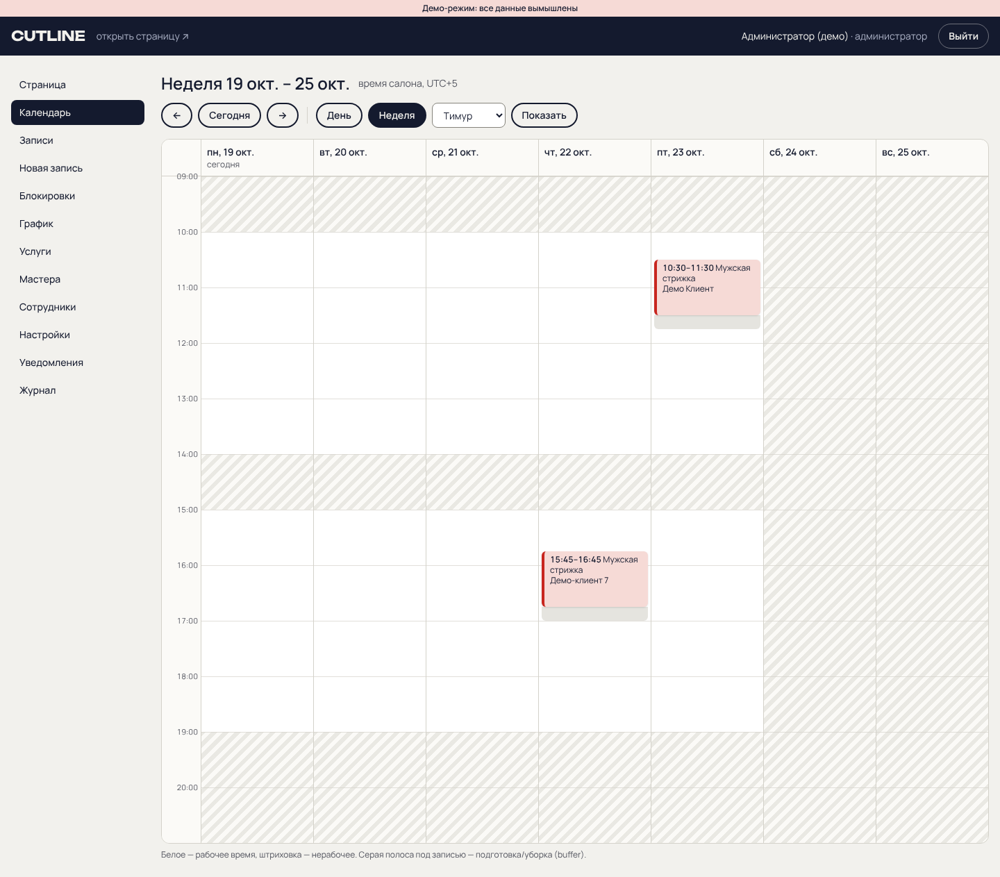 | 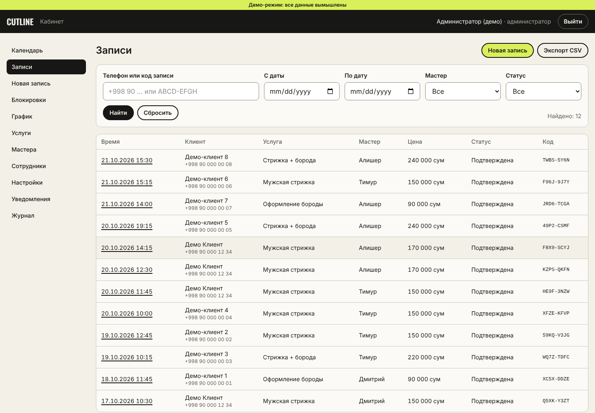 |
| 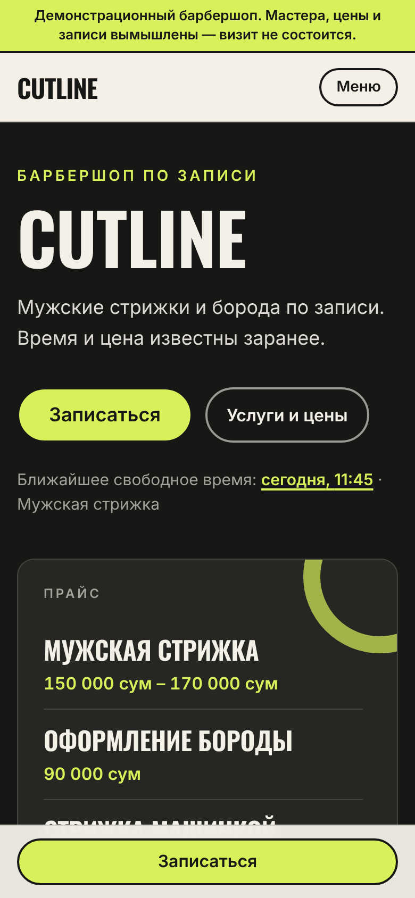 | 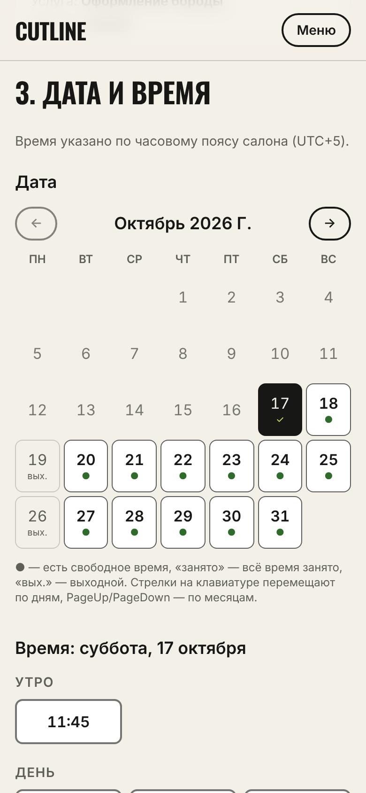 |
| 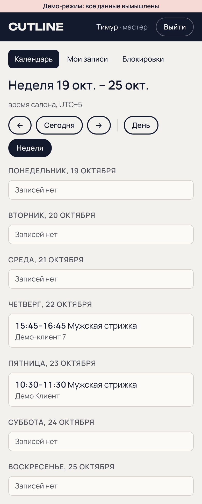 | |
